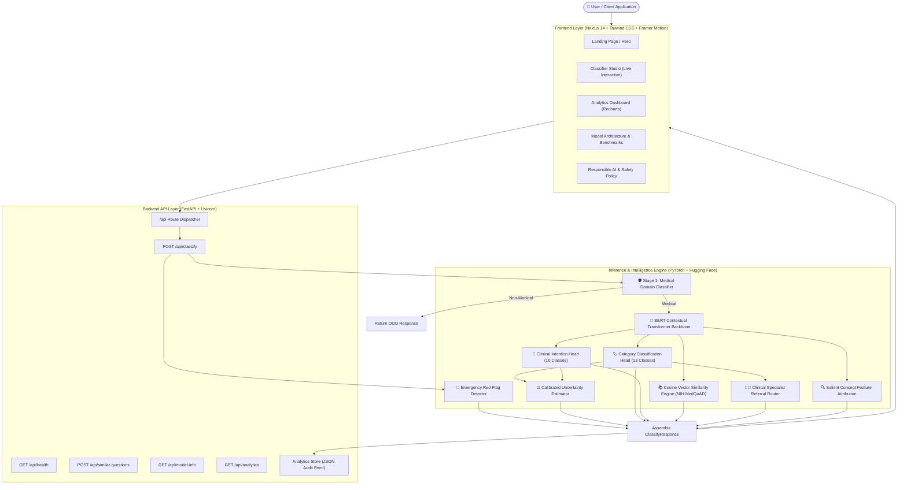

# MedClass AI — System Architecture

MedClass AI is an autonomous, end-to-end medical question intelligence platform. It processes natural language healthcare inquiries to determine domain legitimacy, clinical specialty category, communication intention, uncertainty estimation, and verified reference evidence.

---

## 1. High-Level Architecture Overview

---

## 2. Layer Decomposition

### A. Frontend Presentation Layer
- **Framework:** Next.js 14 App Router, React 18, TypeScript.
- **Styling & Interaction:** Tailwind CSS with a healthcare/AI palette (teal, slate, indigo, rose for emergency triage), subtle glassmorphism cards, and Framer Motion transitions.
- **Data Visualization:** Recharts rendering dynamic category bar charts, intent distribution charts, and multi-model benchmark graphs.

### B. Backend Application Layer
- **Framework:** FastAPI with asynchronous lifespan management.
- **Model Warmup:** Pre-loads weights and vector indices into memory at boot time to achieve sub-20ms inference latency without per-request cold starts.
- **Telemetry & Validation:** Enforces Pydantic schema validation, logs processing latency (`X-Process-Time-Ms`), and safely handles server errors without leaking stack traces.

### C. Deep Learning & Transformer Inference Engine
- **Stage 1 (Domain Filtering):** Binary classification verifying whether an inquiry belongs to the biomedical domain or open-domain trivia/technical chatter.
- **Stage 2 (Multi-Task Representation):** 
  $$z = \text{LayerNorm}(\text{GELU}(W_p \cdot \text{Pool}(\text{Transformer}(x)) + b_p))$$
- **Joint Heads:**
  - $P(\text{Category} \mid x) = \text{Softmax}(W_{cat} \cdot z)$
  - $P(\text{Intent} \mid x) = \text{Softmax}(W_{int} \cdot z)$
- **Uncertainty Estimator:** Calibrates confidence thresholds ($< 0.60$) and entropy spreads to detect underspecified questions.
- **Emergency Detector:** Rule-based red-flag triage scanning for critical symptoms (acute chest pain, stroke symptoms, respiratory distress, anaphylaxis).
- **Knowledge Retrieval:** Cosine vector search over 4,000+ curated NIH MedQuAD QA pairs.
